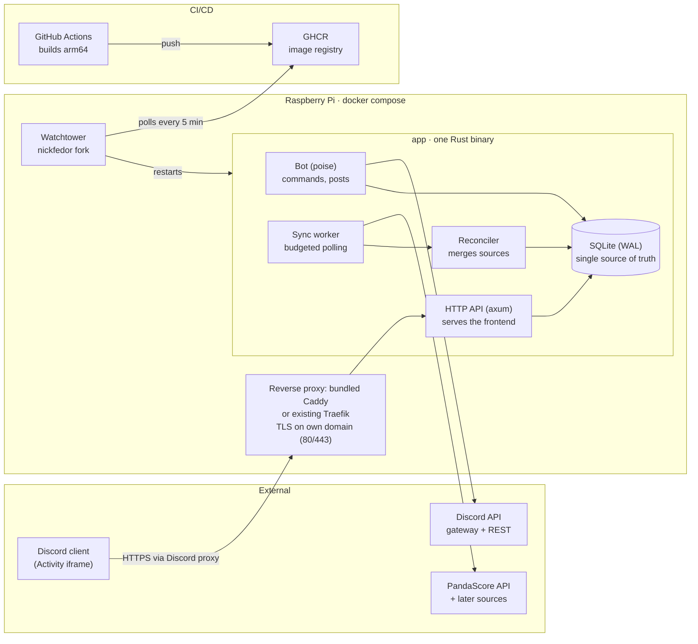

# Architecture

Only the sync worker calls external data APIs; everything else reads the own SQLite database, which is the single source of truth. Bot, HTTP API, sync worker and reconciler run as tokio tasks in **one Rust binary**.

## System overview

Arrows point from caller to callee.

## Components

| Component | Crate | Responsibility | Tickets |
| --- | --- | --- | --- |
| Domain | `domain` | Types, pick validation, scoring, achievements, the admin rule. Pure functions, no I/O. | T07, T10, T11, P6 |
| Store | `store` | sqlx repositories and migrations. | T02 |
| Sources | `sources` | `SourceAdapter` trait and adapters (PandaScore, manual, fixture). Fetch and convert only, never write the DB. | T03–T05 |
| Sync | `sync` | Scheduler with API budget, reconciler, lock ticker, domain events. | T03, T06 |
| HTTP API | `api` | Auth (Discord OAuth via Embedded App SDK), JSON API, image proxy, static frontend. | T07, T10, T12–T15 |
| Bot | `bot` | Slash commands, channel posts, Activity launch. | T08, T09 |
| App | `app` | Binary: config, wiring, graceful shutdown, CLI subcommands. | T01 |
| Frontend | `frontend/` | React Activity: Matches, Events, Leaderboard, Me (+ Admin in P5). | T07, T12–T15 |

## Data flow

1. **Sync** (T06) decides which external calls to make, by match state and within the per-source budget.
2. **Adapters** (T03, T04) return source-neutral DTOs. Raw payloads are stored in `source_records` for replay.
3. The **reconciler** (T03) maps DTOs to canonical entities via `external_refs`, applies field precedence (`manual` first), and emits **domain events** only on real change: `MatchCreated`, `MatchRescheduled`, `MatchStarted`, `MapUpdated`, `MatchFinished`, `MatchCanceled`, `ResultCorrected`.
4. Event consumers:
   - **lock** (T10, plus the lock ticker in T06): picks become read-only at match start;
   - **settlement** (T11): recompute points for the match, upsert `pick_results`;
   - **announcements** (T08), **reminders** (P1), **achievements** (P6).
5. **Bot and Activity** only read the DB, and write picks and settings.

## Key invariants

- Times are UTC end to end; only the frontend converts to local time.
- Team A/B orientation of a match is fixed at creation; all scores (source data and picks) are stored relative to it. The reconciler flips swapped source data, never the match.
- Settlement is a recompute from history, never a delta, so corrections and replays are safe.
- Every identity and guild claim from the browser is re-verified on the server.
- External IDs never appear in the public API.

## Data model

The canonical schema is specified in [T02](tickets/T02-domain-model-database.md). Main tables: `teams`, `events`, `stages`, `matches`, `maps`, `external_refs`, `source_records`, `users`, `guild_members`, `picks`, `pick_maps`, `pick_revisions`, `pick_results`, `guild_settings`, `followed_events`, `audit_log`, `sync_state`. T03 adds `field_sources` (which source set each value) and `unlinked_refs` (the unlinked queue); see [ADR 0004](adr/0004-source-adapters-reconciliation.md). T07 adds `sessions` (hashed bearer tokens); see [ADR 0007](adr/0007-discord-auth-sessions.md).

## Deployment

- Compose services on the Pi (T16, [ADR 0008](adr/0008-container-image-and-proxy.md), setup in [deploy/README.md](../deploy/README.md)):
  - `app`, with no published ports;
  - the reverse proxy, either:
    - `caddy` (compose profile `caddy`, the default), publishing 80/443 with automatic Let's Encrypt certificates; or
    - an **existing Traefik** outside this stack: `docker-compose.traefik.yml` attaches `app` to Traefik's network, and the route comes from `docker-compose.traefik-labels.yml` (Docker labels) or `traefik/pickem.yml` (Traefik's file provider);
  - `watchtower`, updating only the `app` container: label-enable mode plus the scope `cs2-pickem`, so the proxy and other stacks are never touched (T17, [ADR 0009](adr/0009-ci-cd-and-watchtower.md)).
- The Discord Activity URL mapping `/` points to the owner's domain. Discord's proxy forwards Activity requests to the reverse proxy, which forwards them to `app:8080`.
- Images are built in GitHub Actions for arm64 and amd64 (cross-compiled on one amd64 runner, not under QEMU) after the gates pass, and pushed to GHCR as `latest`, `sha-<short>`, and `vX.Y.Z` plus `stable` on releases. Watchtower polls the tag set in `IMAGE_TAG` every 5 min.

## Risks

| Risk | Effect | Mitigation |
| --- | --- | --- |
| PandaScore's free plan lacks per-map round scores or live data | Exact map-score picks can't be settled automatically | **Confirmed by the T04 spike ([ADR 0001](adr/0001-pandascore-coverage.md)): no round scores or map names on the free plan.** Manual entry (T05); pending-then-void rule (T11); a second adapter later. Liquipedia's API asks for a named User-Agent and has usage terms. HLTV has no official API; scraping it is fragile and likely against its terms. |
| Discord Activity APIs change (Entry Point command, launch response, launch parameters) | Launch buttons or deep links break | T08 checks current docs; the pending-view deep link needs no special API. |
| Discord limits unverified Activities to the app's team and app testers, in servers under 25 members | Most members of a larger server can't open the Activity | Checked in T07 ([discord-setup.md](discord-setup.md#who-can-launch-it)); open question in [vision.md](vision.md#open-questions): app verification, or app testers for small groups. |
| Public URL for the Pi | The Activity can't load without HTTPS | Own domain, ports 80/443 forwarded, the bundled Caddy or an existing Traefik with automatic certificates; only the reverse proxy is exposed and the host is hardened (T16). DS-Lite or CGNAT connections can't forward IPv4 ports. Use DynDNS if the IP changes. |
| Unattended updates by Watchtower | A bad release goes live by itself | CI gates, backward-compatible migrations, `IMAGE_TAG` pinning for rollback, backups (P4). |
| SD-card wear and corruption | Data loss | SSD recommended (T16), backups (P4). |

## Sources

Checked 16 Nov 2026:

- [Watchtower archived on 17 Dec 2025; fork nickfedor/watchtower](https://jacar.es/en/watchtower-automatic-docker-updates/) · [containrrr/watchtower discussion](https://github.com/containrrr/watchtower/discussions/1993)
- [PandaScore pricing (free plan: 1,000 requests/hour)](https://pandascore.co/pricing) · [PandaScore changelog: 60 requests/min on the free tier](https://developers.pandascore.co/changelog/updated-free-tier-rate-limits) · [PandaScore rate limits](https://developers.pandascore.co/docs/rate-and-connections-limits)
- [Discord Activities: local development and URL mapping](https://docs.discord.com/developers/activities/development-guides/local-development) · [Discord Activities: networking](https://docs.discord.com/developers/activities/development-guides/networking)
- [Free esports data sources, incl. Liquipedia API User-Agent requirement](https://sportsapis.dev/esports-api)
- [HLTV has no official developer API](https://parse.bot/marketplace/b392d518-21a4-4ad2-b311-3872d34d62d6/hltv-org-api)
